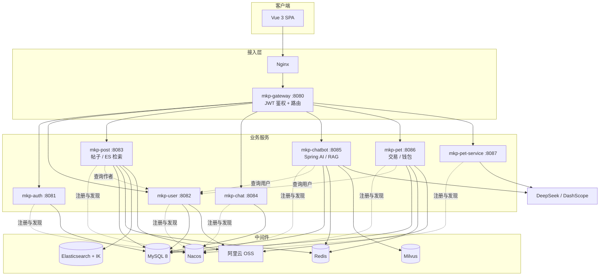

# MKP · 智能宠物社区平台

一个基于 **Spring Cloud 微服务 + Vue 3** 的宠物社区平台，覆盖内容社区、托管交易与 AI 助手三大板块。

- **后端**：8 个可独立部署的微服务 + 2 个公共模块，JDK 21 / Spring Boot 3.5 / Spring Cloud 2025 / Spring Cloud Alibaba 2025 / Nacos
- **前端**：Vue 3 + Vite + Element Plus + ECharts，共 21 个页面（含 6 个后台管理页）
- **中间件**：MySQL 8 / Redis 7（缓存与计数）/ Milvus 3.0（向量库）/ Elasticsearch 7.17 + IK / 阿里云 OSS
- **AI**：Spring AI 1.1 + Spring AI Alibaba 1.1（DashScope / Qwen）、ChatClient + 原生工具调用、DashScope text-embedding-v3（1024 维）+ Milvus HNSW 向量检索（父子块 + FAQ 双集合）

## 功能概览

| 板块 | 功能 |
| --- | --- |
| 用户与鉴权 | 注册 / 登录、JWT 统一鉴权、角色（普通用户 / 管理员） |
| 内容社区 | 发帖（图文，OSS 上传）、话题、评论、点赞、浏览量、全文检索 |
| 好友与私信 | 好友关系、会话消息、未读通知 |
| 托管交易 | 发布（寄养 / 出售）、申请与接受、订单状态机、钱包（可用 + 冻结）、支付 / 退款流水、评价、交易广场 SSE 实时刷新 |
| 宠物服务 | 按物种 / 品种 / 月龄 / 体重生成 AI 养护建议 |
| AI 助手 | Spring AI Alibaba（Qwen + DashScope Embedding）、原生工具调用（知识库 / 社区 / 集市）、SSE 流式输出、RAG 语义检索、Prompt 模板管理 |
| 后台管理 | 仪表盘、用户、帖子、评论、知识库、Prompt 模板 |

## 系统架构



## 模块说明

| 模块 | 端口 | 职责 | 关键实现 |
| --- | --- | --- | --- |
| `mkp-common` | — | 公共实体 / DTO / 常量 / 统一返回 / JWT 工具 / 用户上下文拦截器 | — |
| `mkp-api` | — | Feign 客户端与 fallback 降级 | — |
| `mkp-gateway` | 8080 | 统一入口、JWT 鉴权、路由转发、CORS | `AuthGlobalFilter` |
| `mkp-auth` | 8081 | 注册、登录、签发 token | 唯一带单元测试的模块 |
| `mkp-user` | 8082 | 用户资料、好友关系、管理员用户管理 | — |
| `mkp-post` | 8083 | 帖子 / 评论 / 点赞 / 浏览量、ES 全文检索、OSS 上传 | 浏览量 Redis 计数 + 定时刷库；ES 索引事务后异步同步 |
| `mkp-chat` | 8084 | 会话消息、未读通知 | 跨服务用户信息 Redis 缓存 |
| `mkp-chatbot` | 8085 | AI 助手：Spring AI ChatClient、`@Tool` 工具、RAG、Prompt 模板 | Qwen 对话 + DashScope 向量化；Milvus 父子块向量检索 + 多级降级 |
| `mkp-pet` | 8086 | 发布单 / 申请 / 托管订单 / 钱包资金 / 评价 / 交易广场 SSE | 7 态订单状态机 + CAS 条件更新 |
| `mkp-pet-service` | 8087 | 宠物养护 AI 建议 | Spring AI ChatClient + Qwen（可切 DeepSeek） |

## 快速开始

### 1. 环境依赖

| 组件 | 版本 | 说明 |
| --- | --- | --- |
| JDK | 21 | |
| Maven | 3.8+ | |
| MySQL | 8.0 | 库名 `mkp_db` |
| Nacos | 2.x | 单机 8848 |
| Redis | 7.x | 会话缓存、浏览量计数、向量同步互斥锁 |
| Milvus | 3.0.6（单机 standalone） | 向量库，gRPC 19530；集合 `mkp_knowledge_chunk`（长文档子块）与 `mkp_knowledge_faq`（FAQ 知识） |
| Elasticsearch | 7.17.22 + IK 分词插件 | 未安装可设 `ES_SEARCH_ENABLED=false`，检索降级为 MySQL LIKE |
| Node.js | 18+ | 前端构建 |

### 2. 初始化数据库

```bash
mysql -uroot -p < src/main/resources/MKP.sql

# 增量脚本，按下面顺序执行（后一个依赖前一个建出的表）
mysql -uroot -p mkp_db < mkp-user/src/main/resources/migration_add_sender_id.sql
mysql -uroot -p mkp_db < mkp-chatbot/src/main/resources/migration_add_chatbot_memory.sql
mysql -uroot -p mkp_db < mkp-chatbot/src/main/resources/migration_prompt_template.sql
mysql -uroot -p mkp_db < mkp-pet/src/main/resources/migration_trade.sql
mysql -uroot -p mkp_db < mkp-pet/src/main/resources/migration_trade_v2.sql
mysql -uroot -p mkp_db < mkp-pet/src/main/resources/migration_trade_alter_time.sql
mysql -uroot -p mkp_db < mkp-pet/src/main/resources/migration_wallet.sql
mysql -uroot -p mkp_db < mkp-pet/src/main/resources/migration_wallet_legacy.sql
mysql -uroot -p mkp_db < mkp-pet/src/main/resources/migration_notify_v1.sql
```

`mkp-pet/src/main/resources/recon_trade.sql` 是交易对账查询脚本，不需要执行。

### 3. 配置环境变量

```bash
cp .env.example .env
```

填写真实值后，**需要把 `.env` 里的变量配置成进程环境变量**：`JWT_SECRET` 是代码里通过 `System.getenv()` 读取的，不是 Spring 配置项。IntelliJ IDEA 可安装 EnvFile 插件，或在 Run Configuration → Environment variables 中粘贴。

### 4. 启动

1. 依次启动 MySQL、Redis、Milvus、Nacos、Elasticsearch
2. 启动后端（8 个模块可并行启动，`*Application` 均在 IDE 中直接运行）

   ```bash
   mvn -pl mkp-gateway -am spring-boot:run
   ```

3. 启动前端

   ```bash
   cd frontend
   npm install
   npm run dev     # http://localhost:3000，/api 由 Vite 代理到网关 8080
   ```

### 5. 接口文档

各服务均开启 springdoc，可直接访问服务端口，例如 `http://localhost:8083/swagger-ui/index.html`。

## 关键设计

### 浏览量：Redis 计数 + 脏集合记账 + 定时批量刷库

请求路径只写 Redis（`INCR` 原子吸收并发），并用一个 Set 记录"哪些帖子有未落库增量"，定时任务每 5 秒批量落库。刷库用"先 `SREM` 摘标记（谁摘到谁负责，多实例不会重复处理）+ `GETDEL` 原子取走增量"；落库失败把增量放回计数器并重新标记，下一轮自动重试，不丢数。

### ES 索引一致性：事务提交后事件 + 独立线程池

帖子增删改只发布一个带着 `postId` 的事件，事务提交后（`@TransactionalEventListener(AFTER_COMMIT)`）由独立线程池异步处理：回查数据库拿最终状态，按状态决定写索引或删除，因此新增 / 修改 / 软删除下架共用一套逻辑。线程池队列满时用 `CallerRunsPolicy` 退化为同步执行——宁可慢一点，也不丢索引。检索只取 `id` + 高亮片段，正文回 MySQL 查，保证点赞数、浏览量实时。

### 资金安全：订单状态 CAS + 资金动作同事务回滚

订单状态流转全部使用带条件的 `UPDATE`（`WHERE status = 期望值`）并判断影响行数，未命中即认为并发冲突；钱包是"可用 + 冻结"双账户，扣款同样是条件更新（`WHERE balance >= amount`），影响行数为 0 时抛业务异常。资金动作与状态变更在同一事务内，异常会让两者一起回滚，不会出现"订单已托管但没扣钱"。

### AI 助手：Spring AI + 原生工具调用 + SSE + RAG 降级

模型层用 Spring AI Alibaba 的 DashScope Starter 自动装配 Qwen 对话与 text-embedding-v3；切换 DeepSeek 只改 `spring.ai.model.chat`。对话链路统一走 Spring AI `ChatClient`：工具用 `@Tool` 声明，由模型原生 function calling 调度，不再手写 ReAct 文本协议、正则解析和最多 5 轮的循环控制；SSE 用 `tool` / `token` / `done` 事件推送工具调用与回答片段。向量化走 Spring AI `EmbeddingModel`（DashScope text-embedding-v3，1024 维），向量写入 Milvus：长文档子块进 `mkp_knowledge_chunk`（HNSW + COSINE），FAQ 知识进 `mkp_knowledge_faq`；检索是"子块召回 → parentId 回查 MySQL 父块整节"，按余弦阈值过滤，Milvus 不可用时降级为关键词匹配。长文档那一路带两层过滤：先按 `recall-threshold` 宽松召回 20 条，再用 DashScope `gte-rerank-v2` 对 (query, 子块) 逐条打相关性分、重排后按 `rerank.threshold` 截断；rerank 超时或不可用时自动沿用向量分，不阻塞问答。

## 目录结构

```
MKP/
├── mkp-common/          公共实体、DTO、常量、统一返回、JWT、用户上下文
├── mkp-api/             Feign 客户端与 fallback
├── mkp-gateway/         网关：JWT 鉴权 + 路由
├── mkp-auth/            认证
├── mkp-user/            用户与好友
├── mkp-post/            社区帖子、ES 检索、OSS 上传
├── mkp-chat/            私信会话
├── mkp-chatbot/         AI 助手（Spring AI / RAG / Prompt 模板）
├── mkp-pet/             集市交易、钱包资金、评价
├── mkp-pet-service/     宠物养护 AI 建议
├── frontend/            Vue 3 前端（含后台管理）
└── src/main/resources/  MKP.sql 建表脚本
```

## 注意事项

- `.env` 已被 `.gitignore` 忽略，不会提交；请以 `.env.example` 为模板创建。
- 各服务的 `application.yaml` 中，数据库地址（`127.0.0.1:3306`）、用户名（`root`）、Nacos 地址（`127.0.0.1:8848`）为本机默认值写死，换环境需自行修改；只有数据库密码走 `DB_PASSWORD` 环境变量。
- `JWT_SECRET` 未设置时，代码会回退到内置开发默认值，**生产环境必须显式设置**。
- 目前仅 `mkp-auth` 有单元测试，其余模块无自动化测试。

## 后续计划

- 为交易、资金、检索等核心链路补充单元测试与集成测试
- 提供 Docker Compose 一键启动中间件
- 统一参数校验与异常处理规范
